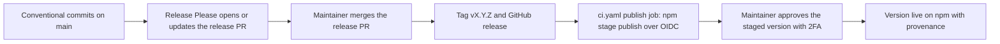

# Releasing

How a pillbox version reaches npm. Releases come from Release Please and npm
trusted publishing; no npm token exists in CI.

## Table of Contents

- [How a release flows](#how-a-release-flows)
- [One-time setup](#one-time-setup)
- [First release](#first-release)
- [Every later release](#every-later-release)
- [Token rotation](#token-rotation)

## How a release flows



| Piece | Where |
| --- | --- |
| Release Please config and manifest | `.github/release-please/` |
| Release and publish jobs | `.github/workflows/ci.yaml` (`release-please`, `publish`) |
| Changelog | `CHANGELOG.md`, written by Release Please |

The publish job runs only when a release was just created and the repository
variable `NPM_TRUSTED_PUBLISHING` is `true`. It uses the GitHub environment
`npm`, installs from the lockfile without caches, runs the tests, and stages the
package. npm generates provenance automatically because the repository and the
package are public.

## One-time setup

| Step | Done by |
| --- | --- |
| Make the repository public, so npm can generate provenance | GitHub settings |
| Give the shared fine-grained PAT `release_please_ci` access to this repository with Contents, Pull requests, and Issues read and write | GitHub account settings |
| Save it as the repository secret `RELEASE_PLEASE_CI`, so CI runs on release PRs | Repository settings |
| Optional: add protection rules to the `npm` environment, for example a required reviewer | Repository settings |

## First release

A trusted publisher can only be configured for a package that already exists,
so the first version is published by hand and carries no provenance.

`initial-version` in `.github/release-please/config.json` sets the first release
to `0.1.0`. The bootstrap manifest's `0.0.0` is not a published release and does
not override Release Please's default initial version on its own. After the
first release, version bumps follow Conventional Commits.

1. Merge the Release Please PR for `0.1.0`. The publish job skips because
   `NPM_TRUSTED_PUBLISHING` is not set.
2. Publish the tag from a clean checkout:

   ```sh
   git switch --detach v0.1.0
   npm ci --ignore-scripts
   npm test
   npm publish
   ```

3. Configure trusted publishing right before the next release. A new trusted
   publisher expires unless it publishes within 2 days.

   ```sh
   npm trust github opencode-pillbox-statusline --repo crag-h4k/opencode-pillbox-statusline \
     --file ci.yaml --env npm --allow-staged-publish
   ```

4. On npmjs.com, set the package's publishing access to "Require two-factor
   authentication and disallow tokens".
5. Set the repository variable `NPM_TRUSTED_PUBLISHING` to `true`.

## Every later release

1. Merge the Release Please PR.
2. Wait for the `publish` job in the tag's CI run.
3. Review the staged version with `npm stage list opencode-pillbox-statusline`
   or the Staged Packages tab on npmjs.com, then approve it with 2FA
   (`npm stage approve <stage-id>`).

## Token rotation

When the shared `release_please_ci` PAT expires or is revoked, Release Please
fails on main pushes. Create a replacement with the same selected repositories
and permissions, then update `RELEASE_PLEASE_CI` in every repository using it.
